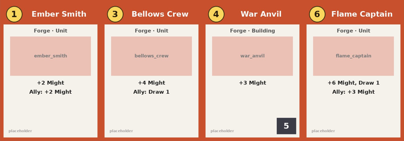

# Cardalyzer

Cardalyzer reads your card data and turns each card's effects into gameplay
in Tabletop Simulator (TTS). You list your cards in a spreadsheet and write
their effects in a short keyword form, like `gold:2; draw:1`. Cardalyzer
checks every card against your game's rules, builds the table, and runs the
effects and the turn structure around them.

You don't need to write Lua for a typical card. Lua is only needed for the
rare card that does something unusual.

The first rules Cardalyzer ships with are for deck-builders: starter decks, a
market row or a supply of piles, drawing, turn cleanup and reshuffling. It
comes with two small original sample games with placeholder art:

- **Ember Guilds** (`games/sample`): a trade-row game. Players buy from a
  changing row of cards, fight with Might and build buildings, and the last
  player standing wins.
- **Lantern Fair** (`games/lantern`): a supply game. Players buy from piles
  that are always for sale, with Action and Buy phases, attacks and
  reactions, and the most renown points win.

To bring a deck-builder you already know to TTS, see the
[porting guide](docs/PORTING.md), and start from the blank game in
`games/template`.



## Contents

- [What works today](#what-works-today)
- [Limits and compatibility](#limits-and-compatibility)
- [Install](#install)
- [Try the sample game](#try-the-sample-game)
- [Tutorial: make your own game](#tutorial-make-your-own-game)
- [Card spreadsheet reference](#card-spreadsheet-reference)
- [Rules file reference](#rules-file-reference)
- [How a turn runs](#how-a-turn-runs)
- [Customising the UI](#customising-the-ui)
- [Customising the table](#customising-the-table)
- [Using card art you already have](#using-card-art-you-already-have)
- [Custom effects](#custom-effects)
- [When something is wrong](#when-something-is-wrong)
- [How it works](#how-it-works)
- [Project layout](#project-layout)

## What works today

Cardalyzer is early. Here's where each milestone stands:

| Milestone | State |
| --- | --- |
| 1. Table and zones: two seats, deck/hand/play/discard zones, market row | done |
| 2. Core loop: starter decks, draw, End Turn cleanup and reshuffle | done; needs in-game testing |
| 3. Market and buying | done; needs in-game testing |
| 4. Effects: keyword effects, ally triggers, bases with defense, attacks | done; needs in-game testing |
| 5. First real game fully playable | 2 to 4 players and reusing existing card art done; needs in-game testing. Next: porting a real game |
| 6. Generalize and build a second tiny game | done: Lantern Fair, a supply game with phases, attacks and reactions; a porting guide and a blank template |
| 7. Workshop template and release | |

So today you can play a full game for 2 to 4 players:

- deal it from your spreadsheet, for the number of players the host picks,
- play cards by dragging them from your hand into your play area, and get their effects,
- trigger ally effects, including cards with two factions and wild cards,
- buy from the market row and fixed piles, or from a supply of piles chosen
  each game (at random or from a preset),
- split a turn into phases (Action, then Buy) with Actions and Buys to spend,
- score points on cards and end the game when a pile or several piles run out,
- attack every other player at once, and answer an attack on your own screen
  by revealing a reaction from your hand,
- answer choices like "2 Gold or 2 Might" and "scrap a card" from an action panel,
- attack any opponent and their buildings, with guard buildings that must fall first,
- knock players out until one is left, who wins,
- use card sheets you already host, such as ones on Steam Cloud,
- give each player their own starting kit (deck, cards in play, stats and hand size),
- save and reload at any point, including mid-choice.

## Limits and compatibility

Cardalyzer is built for one kind of card game, and it's best to know that
before you start.

**What it's made for.** Games where, on your turn, you play cards from your
hand, the cards give you resources or effects, you spend those resources, and
then you clean up and draw. That covers both common kinds of deck-builder:
trade-row games, where a row of cards for sale keeps changing, and supply
games, where the same piles are for sale all game. It also covers the card
play in deck-building board games.

**What it handles:**

- Resources that reset each turn (for buying, attacking, or anything you name)
  and stats that last, like health or points.
- Keyword effects written in the spreadsheet: gain, draw, make an opponent
  discard, scrap from hand or the market, destroy a base, and "choose one".
- Faction ally bonuses, cards that stay in play (bases), and guard cards that
  must be destroyed first.
- A market row with any number of slots (0 removes it), extra rows, piles
  that are always for sale, a supply of piles picked for each game, and
  bought cards going to your discard pile or the top of your deck.
- Turns split into phases, with Actions and Buys (or anything you name) to
  spend on playing and buying.
- Points games: points on cards, ending when piles run out, after a number of
  rounds, or when a shared pool is used up.
- Attacks that hit every other player, and reactions they reveal from their
  hand to block an attack or soften it.
- Monsters and villains in the market that players defeat with their attack
  resource for a reward, instead of buying them.
- Abilities that unlock at a level: "with 10+ Mastery, +5 Might".
- Cards whose effects come on your next turn (they stay in play until then),
  and set-aside areas of each player's own: a mat for cards kept out of the
  deck, set aside until next turn, or called back when the player chooses.
- Turning whole mechanics on or off (allies, bases, scrapping).
- Lua for the occasional card that does something no keyword covers.

**What it doesn't handle yet:**

- **Acting on another player's turn**, beyond reactions. A player can reveal a
  reaction when an attack hits them and answer choices an effect puts to
  them, but there is no stack: no instants, counter-spells or interrupts of
  other kinds. The attacker plays on while others decide whether to react;
  anything still unanswered when their turn ends counts as not revealed.
- **Triggered or always-on abilities** beyond ally bonuses and bases, such as
  "whenever an opponent draws" or "your other cards cost 1 less".
- **Combat between cards.** Attacks go at a player or at their bases. There's
  no blocking and no damage to individual creatures.
- **Coloured or typed costs.** A card costs one number of one buy resource.
- **Targeting** beyond the built-in choices (a card to scrap or discard, a
  base to destroy).
- **Different market behaviour.** You can resize or remove the row, add rows
  and use piles, but not change how a row works: a shop that refreshes each
  round, a draft, or bidding would need new engine code.
- **Boards, tokens and maps.** Only cards are tracked.
- **Hidden roles, trick-taking, bidding, or real-time play.**
- **More than four players, or teams.** Up to four seats fit on the two long
  sides of a rectangular table, and every game is a free-for-all: the last
  player left wins. Three- and four-player games pass the automated tests but
  haven't been played in TTS yet. Four seats need a table about 60 units wide;
  on a smaller one, lower `layout.seatSpread`.
- **The table's own seats.** Cardalyzer removes every hand zone the table
  came with and seats its players itself (see
  [Customising the table](#customising-the-table)).
- **Cards moved by hand.** Cardalyzer tracks the game in its script, not by
  where cards sit. It understands a few drags: a card from your hand onto your
  play area is played, and a market row card, or one you have in play, dropped
  on the scrap pile is scrapped. Any other drag is undone: the card goes back
  where it belongs. Engine cards never merge into decks. Moving a card on
  someone else's behalf, or between players, isn't possible by hand.

**Magic: The Gathering and similar games** aren't a good fit. They rely on the
stack, instants, triggered and static abilities, coloured mana, blocking and
targeting, none of which Cardalyzer has. Only a small share of simple cards
would map to the current keywords; the rest would all be custom Lua.

**Porting a published game** is your responsibility: only share a port on the
Steam Workshop if you have the rights to its cards, names and art. The
[porting guide](docs/PORTING.md) covers the steps.

**Other games** can work if their turn looks like "play cards, gain things,
spend them". Each mechanic lives in its own module that a game turns on or
off, so the engine can grow to cover more kinds of game over time.

## Install

You need:

- **Python 3** and the Pillow library, used to build the mod and draw placeholder card art:
  ```sh
  pip install pillow
  ```
  On Windows, use `py` wherever this README says `python`.
- **Tabletop Simulator**, to play.
- **Lua 5.2** (optional), only to run the automated tests.

Then download the project:

```sh
git clone https://github.com/Oreo12/Cardalyzer.git
cd Cardalyzer
```

## Try the sample game

Building a game always takes the same three commands. Each one reads the
previous one's output:

```sh
python tools/csv2json.py games/sample/cards.csv   # 1. check the spreadsheet, write cards.json
python tools/make_sheets.py games/sample          # 2. draw placeholder card sheets into art/
python tools/bundle.py games/sample               # 3. bundle everything into build/Global.lua
```

You should see:

```
wrote 19 cards to games/sample/cards.json
wrote 1 sheet(s) for 19 cards to games/sample/art
wrote .../build/Global.lua
```

Before loading it in TTS, the card images need a web address TTS can
download from:

1. In TTS, go to **Modding → Cloud Manager** and upload
   `games/sample/art/sheet_1.jpg` and `games/sample/art/back.jpg`. If the repo
   is public, you can skip uploading and use GitHub instead.
2. Open `games/sample/rules.lua` and set `art.baseUrl` to the folder those
   files live in. The engine adds `art/sheet_1.jpg` and `art/back.jpg` to
   the end of it:
   ```lua
   art = {
     -- GitHub (public repos only):
     baseUrl = "https://raw.githubusercontent.com/Oreo12/Cardalyzer/main/games/sample/",
   },
   ```
   Steam Cloud gives every file its own address, so for those you put the full
   URLs in `games/sample/art.json` instead: replace `"art/sheet_1.jpg"` and
   `"art/back.jpg"` with the two URLs. Any value starting with `http` is used
   as-is. Re-running `make_sheets.py` resets these, so paste the URLs in again
   after you regenerate the art.
3. Run `python tools/bundle.py games/sample` again.

Lantern Fair builds the same way, into its own file:

```sh
python tools/csv2json.py games/lantern/cards.csv
python tools/make_sheets.py games/lantern --title "Lantern Fair"
python tools/bundle.py games/lantern -o build/lantern/Global.lua
```

Its `art.baseUrl` already points at this repository on GitHub.

To play:

1. Start a new game in TTS on an empty table.
2. Open **Modding → Scripting**, select **Global**, and paste in the contents of
   `build/Global.lua`. If you use VS Code, the
   [TTS Editor extension](https://marketplace.visualstudio.com/items?itemName=sebaestschjin.tts-editor)
   can push it for you.
3. Click **Save & Play**. The info panel appears on the right of the screen,
   with no background: each player's name in their seat colour, their Health
   as a heart with the number on it (and, once they have buildings in play, a
   shield in front of it for each one, showing its defense), and their deck
   and discard counts. **Tidy table** is a lone button below it, both clear of
   TTS's own Notes button in the corner:
   ```
                     Ember Guilds
          Press New Game to set up a game.
                White        [♥ 40]
                       Deck 0 · Discard 0
                  Red        [♥ 40]
                       Deck 0 · Discard 0
               [Settings] [New Game]
   ```
   Messages, such as "It's not your turn" or "Ember Smith ally: +2 Might",
   appear inside this panel (the last three for everyone, plus a private line
   just above it for the player they concern), and are copied to chat.
   Cardalyzer doesn't use TTS broadcasts for them, because TTS draws broadcast
   text behind custom UI.
4. Sit at White and press **New Game** (only the host can). A setup menu opens
   in the middle of your screen:
   ```
   New Game
   Players [2] [3] [4]
   [Play Game] [Tutorial] [Close]
   ```
   Pick how many play (the table is laid out for them straight away before
   the first game) and press **Play Game**. The menu closes, each seat gets
   its starter deck, the first player draws 3 cards and everyone else draws
   5, and five cards are dealt into the market row. The menu remembers your
   choices for next time.
5. Play your turn. A row of buttons appears just above your hand, only for
   the player whose turn it is, with Play all and End Turn larger and in gold.
   Just above it, everyone sees the active player's Gold (a coin) and Might (a
   reticle) whenever they're above 0. When a card asks you something, the
   question and its options appear in the middle of the screen:
   ```
                 Choose one                     <- middle of the screen
          [+3 Gold] [+3 Might]

                    (3) (5)                     <- Gold and Might
   [PLAY ALL (3)] [Attack Red (5 Might)] [Scrap Hireling] [END TURN]
                                                <- just above your hand
   ```
   **Settings**, next to New Game, is each player's own: **UI size** makes
   all of Cardalyzer's UI smaller or bigger (70% to 155%) for you alone, and
   **Action bar** moves your bar up or down to clear your on-screen hand
   (TTS doesn't tell scripts how big that is), or resets it. **Menus**
   puts your menus and choices in the middle of the screen, or on the left,
   right or top, clear of TTS's own menus. Settings are kept with the save.
   There's no resolution setting: TTS already scales custom UI to each
   player's screen.

   **Getting at TTS's own menus.** TTS always draws a mod's panels on top of
   its own menus (Games, Options, the Escape menu), and mods can't change
   that. So nothing of Cardalyzer's can trap you:
   - every panel in the middle of the screen (New Game, Settings, a choice,
     the winner, the tutorial) has a **Hide** button, which tucks it into a
     **Show** button beside Tidy table. A choice you tuck away still waits
     for your answer;
   - **Hide UI**, beside Tidy table, hides all of Cardalyzer's panels for you
     alone, leaving only **Show Cardalyzer**. You can also set a key for it
     in TTS's **Options → Game Keys** ("Cardalyzer: hide or show the UI");
   - **Menus** in Settings moves your menus away from the middle.

   Panels can't be dragged: TTS puts a dragged panel back each time the UI is
   redrawn, which happens after every move.
   The market turns to face whoever's turn it is, so its cards always read
   the right way up.
   - **Play a card** by dragging it from your hand into your play area (the
     row in front of you), or press **Play all**. Its effects apply at once,
     and the info panel shows your new totals.
   - **Buy** with the **Buy** button on a market card or the Hireling pile.
     It goes to your discard pile, and the empty slot refills.
   - **Answer prompts.** When a card needs a choice, such as picking an option,
     a card to scrap or a card to discard, the action panel lists your options
     as buttons.
   - **Attack** with an opponent's Attack button: all your Might goes to that
     player's Health. Guard buildings (the sample's Stone Wall) have to be
     destroyed first. A player at 0 Health is out, and the last one left wins.
   - **End Turn**. Your played cards and your hand go to your discard pile,
     buildings stay, you draw 5, and play passes to the next seat. When a deck runs out,
     the discard pile is shuffled into it automatically.
6. If cards end up somewhere odd, press **Tidy table**. It redraws every pile
   from the game state.
7. New to the table? Press **Tutorial** in the setup menu. It opens a short
   guide in the middle of your screen, only for you, covering what Cardalyzer
   does, where the info panel, action panel and messages are, and how the table
   is laid out. **Hide button** removes the Tutorial button for you (it stays
   hidden after a reload); type `!tutorial` in chat to get it back.

## Tutorial: make your own game

This walk-through builds a tiny pirate game called **Pirate Port**. Players
earn *Doubloons* to buy cards, fire *Cannons* to attack, and each ship has
*Hull* points. Every snippet below was run through the real tools.

### 1. Copy the sample

```sh
cp -r games/sample games/pirate
```

On Windows, copy the folder in Explorer instead.

### 2. Write the cards

Open `games/pirate/cards.csv` in Excel, Google Sheets or a text editor, and
replace its contents with:

```csv
id,name,deck,faction,type,cost,copies,effects,ally_effects,scrap_effects,defense,text
deckhand,Deckhand,starter,none,unit,0,7,doubloons:1,,,,
gunner,Gunner,starter,none,unit,0,3,cannons:1,,,,
smuggler,Smuggler,market,rogue,unit,2,4,doubloons:2,draw:1,,,
broadside,Broadside,market,navy,unit,4,3,cannons:4,cannons:2,,,
fort,Harbor Fort,market,navy,building,5,2,cannons:2;hull:1,,,6,
parrot,Lucky Parrot,market,rogue,unit,3,2,custom:luckyParrot,,,,"Draw 2 if your hull is below 10."
```

Here's how to read a few of those rows:

- **Deckhand**: every player starts with 7 copies (`deck` is `starter`). It
  gives 1 Doubloon when played.
- **Smuggler**: 4 copies go into the market deck, and it costs 2. It gives
  2 Doubloons. If another Rogue card is in play, it also draws a card
  (`ally_effects`).
- **Harbor Fort**: a `building`, so it stays in play between turns. It has
  6 defense, gives 2 Cannons and repairs 1 Hull. The `;` separates the two
  effects.
- **Lucky Parrot**: its effect is too unusual for a keyword, so it names a
  custom effect. You'll write that in step 4.

If you save the sheet from Excel, choose **CSV UTF-8**.

### 3. Write the rules

Replace `games/pirate/rules.lua` with:

```lua
return {
  name = "Pirate Port",
  seats = { { color = "Blue" }, { color = "Green" } },

  -- Each key becomes an effect keyword: doubloons:2, cannons:4
  -- spend says what the Buy and Attack buttons use.
  resources = {
    { key = "doubloons", label = "Doubloons", spend = "buy" },
    { key = "cannons", label = "Cannons", spend = "attack" },
  },
  -- Stats persist between turns and are keywords too: hull:1
  stats = { { key = "hull", label = "Hull", start = 20 } },
  -- Attacks lower Hull; a captain at 0 is sunk.
  win = { type = "stat_depleted", stat = "hull", atOrBelow = 0 },

  handSize = 5,
  openingHand = 5,
  market = { rowSize = 4, buyTo = "discard" },

  factions = {
    rogue = { label = "Rogue", color = "#B8862B" },
    navy = { label = "Navy", color = "#2B4FB8" },
  },
  cardTypes = { unit = { persistent = false }, building = { persistent = true } },
  mechanics = { allies = true, persistent = true, scrap = true },
  art = { baseUrl = "" }, -- fill in once the images are uploaded

  customEffects = {
    -- step 4
  },
}
```

Notice that no engine code changed. The names `doubloons`, `cannons` and `hull`
are new keywords simply because the rules list them.

### 4. Add the custom effect

Fill in `customEffects` with the Lucky Parrot:

```lua
customEffects = {
  luckyParrot = {
    text = "Draw 2 if your hull is below 10", -- shown on the card's tooltip
    apply = function(game, seat, ctx)
      if game.state.players[seat].stats.hull < 10 then
        game:draw(seat, 2)
      end
    end,
  },
},
```

### 5. Build it

```sh
python tools/csv2json.py games/pirate/cards.csv
python tools/make_sheets.py games/pirate --title "Pirate Port"
python tools/bundle.py games/pirate
```

The second command colours each card's frame by its faction, using the
colours from `rules.lua`. Upload the sheets, set `art.baseUrl`, rebuild, and
load `build/Global.lua` into TTS as in [Try the sample game](#try-the-sample-game).
After **New Game**, the panel shows your game's own names:

```
Turn 1 · Blue to play
▶ Blue: Doubloons 0 · Cannons 0 · Hull 20 · Deck 5 · Discard 0
   Green: Doubloons 0 · Cannons 0 · Hull 20 · Deck 5 · Discard 0
```

### 6. Change things and rebuild

Run the same three commands after every change:

| You changed | Re-run |
| --- | --- |
| `cards.csv` | all three |
| `rules.lua` only | `bundle.py` (and `make_sheets.py` if you changed faction colours) |
| engine code in `src/` | `bundle.py` |

Then paste the new `build/Global.lua` into TTS. A saved game keeps its state
across a reload.

## Card spreadsheet reference

One row per card. The column order doesn't matter, but the names do.

| Column | Required | Meaning | Example |
| --- | --- | --- | --- |
| `id` | yes | Unique id: lowercase letters, digits, `_` | `war_anvil` |
| `name` | yes | Name shown on the card | `War Anvil` |
| `deck` | no (default `market`) | Which pile the card starts in: `starter`, `market`, `fixed` or `dealt` (see below) | `market` |
| `faction` | no (default `none`) | Faction for ally effects and frame colour. Two factions: `forge/grove`. `any` counts as every faction; `anyname` counts as any card name for same-name allies | `forge` |
| `type` | no (default `unit`) | A type from `cardTypes` in the rules. Several types: `action/attack`. The card then has all of them: phases, prompts and play costs match any of them, and their `cardTypes` flags combine (a `unit/wall` stays in play and guards) | `building` |
| `cost` | yes | Price in the market | `4` |
| `copies` | yes | How many copies exist (see `deck`) | `1` |
| `effects` | yes (may be empty) | What happens when it's played | `might:3` |
| `ally_effects` | no | Extra effects when another card sharing a faction is in play; once per turn | `draw:1` |
| `double_ally_effects` | no | Like `ally_effects`, but needs two other cards of the faction in play | `might:3` |
| `scrap_effects` | no | Effects when you scrap it (remove it from the game). A faction prefix (`forge=might:8`) means it can only be scrapped while that ally is in play | `might:2` |
| `condition` | no | For `objective` cards: the custom effect whose `check` says the goal is met | `sevenShips` |
| `points` | no | Victory points the card is worth at the end of a points game (`win.type = "points"`). Negative for a card that costs points | `3` |
| `starting` | no | Copies in each player's starting deck, for a card that is also in a pile (`fixed` or `supply`) | `6` |
| `next_effects` | no | Effects at the start of the owner's next turn. The card stays in play until then (not discarded at cleanup), then goes at the end of that turn | `draw:2` |
| `react_effects` | no | A reaction: when an opponent's attack hits you, you may reveal this card from your hand for these effects. `block` makes the attack miss you | `block` |
| `set` | no | Which set the card belongs to (a `key` from `rules.sets`); players choose sets in the New Game menu | `expansion1` |
| `defense` | no | Damage needed to destroy a persistent card | `5` |
| `text` | no | Extra rules text shown on the card | `Ally: take a free card.` |

The `deck` values work like this:

- **`starter`**: every player gets `copies` of it in their starting deck.
- **`market`**: `copies` are shuffled into the market deck, which refills the row.
- **`market:<key>`**: the same, for one of the extra markets in `rules.markets`.
- **`fixed`**: a pile of `copies` that's always available next to the row.
  The sample's Hireling works this way. `rules.pileSizes` can size it by the
  number of players.
- **`supply`**: one of a pool of piles. Each game, `rules.supply.count` of
  them are laid out as piles next to the fixed ones, picked at random or from
  a preset the host chooses in the New Game menu (Lantern Fair's action cards).
- **`dealt`**: at the start, each player is dealt `rules.deal.count` of these
  at random, straight into play (Star Realms' Gambits).
- **`objective`**: secret goals. Each player is dealt `rules.objectives.count`
  face down. The card's `condition` column names a custom effect whose
  `check(game, seat, ctx)` says the goal is met; a Complete button then
  appears on that player's action bar, and completing it applies the card's
  `effects` as the reward.

### Writing effects

An effect is `keyword:amount`. Put `;` between several effects. Spaces are
fine.

| You write | It means |
| --- | --- |
| `gold:2` | +2 to the `gold` resource this turn |
| `health:-3` | Lose 3 from the `health` stat |
| `draw:1` | Draw a card (reshuffling if needed) |
| `opponent_discard:1` | Each opponent discards a card at the start of their next turn |
| `scrap_hand:1` | You may scrap a card from your hand or discard pile |
| `scrap_required:1` | You must scrap a card from your hand or discard pile (if you have one) |
| `scrap_from_hand:1`, `scrap_from_discard:1` | You may scrap a card from just your hand, or just your discard pile (add `_required` to make it a must) |
| `discard:1` | Discard a card (required) |
| `cycle:2` | Discard up to 2 cards, then draw that many |
| `free_buy:4` | Take a card costing 4 or less from the market row for free. `free_buy_hand:4` puts it into your hand, `free_buy_top:4` on top of your deck, `free_ship_top:4` takes a `ship` onto your deck |
| `bounce_base:1` | Return an opponent's base to its owner's hand |
| `scrap_row:1` | You may scrap a card from the market row (it refills) |
| `destroy_base:1` | You may destroy an opponent's building, ignoring guards |
| `draw_discard:1` | Draw a card, then discard a card |
| `reminder` | Show the card's `text` to the player until they click Done (for rules not automated yet) |
| `gain:silk` | Gain the top card of the `silk` pile (a `fixed` or `supply` pile) into your discard pile |
| `gain_card:4` | Gain a card costing 4 or less from the piles or any market row |
| `defeat_free:4` | Defeat a card costing 4 or less (a type with `defeat = true`) for free, and get its reward |
| `opponents_gain:gossip` | Attack: each opponent gains the top card of the `gossip` pile |
| `opponents_discard_to:3` | Attack: each opponent discards down to 3 cards in hand, straight away |
| `block` | In `react_effects`: the attack doesn't affect you |
| `set_aside:tavern` | Put this card into your `tavern` area (one of `rules.areas`) |
| `set_aside_hand:later` | Put a card from your hand into your `later` area |
| `gold:2; draw:1` | Both |
| `gold:3 \| might:3` | The player picks one |
| `custom:luckyParrot` | Run `rules.customEffects.luckyParrot` |

In any column, an effect can need a level first: `mastery>=10=might:5`
gives 5 Might only while the player has 10 or more Mastery. The left side is
any resource or stat, or a count: `hand`, `deck` and `discard` (cards in
them), `played` (cards played this turn) or `defeated` (cards defeated this
turn). The comparisons are `>=`, `<=`, `>` and `<`. Tooltips show it as
"(Mastery 10+) +5 Might". A typo in the left side is reported when the mod
loads.

In `ally_effects` only, an effect can name the faction it needs:
`veil=scrap_row:1` fires when a Veil card is in play, whatever the card's own
faction. Without a prefix, an ally effect needs any card that shares one of
its factions. The prefix `samename=` needs another card with the same name
(or one whose faction is `anyname`) in play. Each ally effect fires at most
once per turn.

Some keywords are always available:

- `draw`, `opponent_discard`, `scrap_hand`, `scrap_required`, `scrap_row`, `destroy_base`,
  `draw_discard` and `reminder`.
- `gain`, `gain_card`, `defeat_free`, `opponents_gain`, `opponents_discard_to`, `block`,
  `set_aside` and `set_aside_hand`. `gain` and `opponents_gain` take a card id
  instead of a number; `set_aside` and `set_aside_hand` take an area's key.
- `custom:<name>`.
- One keyword per resource and stat in your rules, using its `key`.

## Rules file reference

These are the fields in `games/<yours>/rules.lua`:

| Field | Example | Meaning |
| --- | --- | --- |
| `name` | `"Ember Guilds"` | Title shown on the panel |
| `seats` | `{ {color="White"}, {color="Red"} }` | Player colours in turn order; optional `name` per seat. Seats sit along the bottom of the table from left to right, then back along the top. A game for fewer players uses the first ones |
| `players` | `{min=2, default=2}` | How many of the seats can play. The host picks from `min` to the number of seats in the info panel. Leave out to always use every seat |
| `resources` | `{ {key="gold", label="Gold", spend="buy"} }` | Per-turn pools, reset at end of turn to `start` (0 unless given). `spend = "buy"` pays for cards, `spend = "attack"` powers attacks. Optional `icon` (see `ui.iconBaseUrl`) |
| `stats` | `{ {key="health", label="Health", start=40} }` | Values that persist between turns. Optional `icon` |
| `handSize` | `5` | Cards drawn at the end of each turn |
| `turn` | see below | How a turn runs: phases, costs for playing and buying, what's kept between turns, and hooks |
| `openingHand` | `{3, 5}` or `5` | First hand per player in turn order (the last number repeats); one number means everyone draws that many. `{players = {[2] = {3, 5}}, otherwise = {3, 4, 5}}` depends on the number of players |
| `openingHands` | `{ {label="Rulebook", hands={3, 5}}, {label="Everyone 5", hands=5} }` | Several opening-hand rules to choose from in the New Game menu (the first is the default; the choice is remembered). Each `hands` takes any `openingHand` form; an optional `about` explains the option in plain words (its tooltip, and the tutorial's setup page). `openingLabel` renames the row (default "Starting hands"). Overrides `openingHand` |
| `firstSeat` | `1` | Which seat goes first |
| `market.rowSize` | `5` | Face-up market slots. `0` for a game with no market row (and no market deck on the table) |
| `market.buyTo` | `"discard"` or `"deck_top"` | Where bought cards go |
| `deal` | `{count=2}` | How many `dealt` cards each player gets at the start |
| `objectives` | `{count=3, perTurn=1, toWin=3, label="Missions"}` | Secret goals (`objective` cards): how many each player gets, how many can be completed per turn, and how many completed win the game |
| `kits` | `{ {key="red", set="red_kit", label="Red", handSize=6, stats={health=60}, requires={"exp1"}} }` | Premade starting kits. With Starting decks set to the kit option (named `kitName`, default "Kit") in the New Game menu, every player picks their own in a kit menu (the **Your kit** button on the right opens it for anyone): a premade kit, a random one (a premade kit nobody else picked), or a custom mix (see `kitParts`). Anyone who doesn't pick gets a random one. A kit's set supplies that player's `starter` cards and their `dealt` cards in play; its `market` cards join the market deck; `stats`/`handSize` replace the player's. A kit's set is never dealt otherwise. `requires` lists sets switched on when the kit is picked. `kitLabel` names the menu row (default "Starting decks") |
| `kitParts` | `{ {key="leader", label="Leader", deck="dealt", type="leader", by="kit", stats=true}, {key="tricks", label="Tricks", deck="dealt", type="trick", count=2} }` | What a custom kit is mixed from. Each part takes cards of one `deck` (and `type`) from the kits' sets: `by = "kit"` picks which kit supplies the part (`stats = true` also brings that kit's stats and hand size); `count = n` picks n single cards from all the kits. Parts left unpicked are picked at random. Leave out for no custom option |
| `kitRequires` | `{"exp1"}` | Sets switched on when the host turns kits on |
| `supply` | `{count=8, label="Supply", presets={ {label="First game", cards={"juggler", "tea_house"}, about="…"} }, default=1}` | The supply (`supply` cards): how many piles each game uses, picked at random or from a preset. With presets, the New Game menu offers Random and each preset (`about` is its tooltip); `default` picks a preset until the host chooses. Piles are laid out cheapest first |
| `pileSizes` | `{ gossip = function(players) return 10 * (players - 1) end, banner = {[2]=8, otherwise=12} }` | How many cards a `fixed` or `supply` pile starts with, by card id: a number, a table by player count, or a function of it. Others use `copies` |
| `layout.areas.fixed` | `{columns=8}` | Lay the piles out in rows of up to this many, the supply starting its own row. With no market row they're centred |
| `areas` | `{ {key="exile", label="Exile"}, {key="later", label="Set aside", at="nextTurn"}, {key="tavern", label="Tavern", at="call", returns="play"} }` | Set-aside areas: a pile of each player's own beside their discard pile, for cards out of their deck but still theirs (they count for points). `at` says what brings cards back: `"nextTurn"` (the start of the owner's next turn), `"call"` (a Call button on the owner's turn), or nothing (they stay). `returns` says where they go: `"hand"` (default), `"play"` (their effects apply) or `"discard"`. `shown = false` keeps an area off the table; `layout.areas.<key> = {along, out}` moves it |
| `market.returnScrapped` | `true` | A scrapped card from a fixed pile goes back to its pile instead of the scrap pile (Star Realms' Explorers) |
| `sets` | `{ {key="base", label="Base Game", always=true}, {key="exp1", label="Expansion", default=true} }` | Sets of cards (named in the `set` column) the host switches in or out in the New Game menu. `always` sets can't be switched off; `default` ones start on. Cards with no `set` are always in. `about` is the set's tooltip in the menu |
| `market.faceActive` | `false` | Leave out to turn the market's cards to face the player whose turn it is; `false` keeps them facing seat 1 |
| `market.turnsWithPlayer` | `true` | The whole market (row, piles, outlines) turns to face the player whose turn it is, with its cards gliding to their new places. Best with `layout.seating = "around"` |
| `markets` | `{ {key="heroes", label="Heroes", rowSize=3} }` | Extra markets, each with its own deck and row of cards for sale. A card joins one with `deck = market:heroes` in the spreadsheet. The rows stack beside the main one, and the seats move back to make room; `layout.areas.heroes = {along, out}` places one. They share the main market's scrap pile; fixed piles stay with the main market |
| `factions` | `forge = {label="Forge", color="#C8502D"}` | Faction labels and frame colours |
| `cardTypes` | `wall = {persistent=true, guard=true}` | Types. Persistent ones stay in play and apply their effects again each turn; guard ones must be destroyed before their owner or other buildings can be attacked. `replay = false`: a persistent card doesn't apply its effects again each turn. `target = false`: it can't be attacked or destroyed (a hero that stays until you scrap it). `event = true`: revealed into the market row, it resolves at once for the player whose turn it is, then goes to the scrap pile and the slot refills. `defeat = true`: a monster or villain. In the market it has a Defeat button instead of Buy: defeating it costs its `cost` in the attack resource, gives its `effects` as the reward, and sends it to the scrap pile. It can't be bought or taken for free. `hire = true`: in a market row it also has a Hire button: hiring pays its cost like a buy and puts it straight into play for its effects, and at the end of the turn it goes to the bottom of its market's deck instead of to the player (Shards of Infinity's Mercenaries) |
| `mechanics` | `{allies=true, persistent=true, scrap=true}` | Turn whole mechanics on or off |
| `win` | `{type="stat_depleted", stat="health", atOrBelow=0}` | How the game is won. `stat_depleted`: attacks lower this stat; a player who drops to it is out (no more turns, can't be attacked); the last player left wins. `points`: the highest score wins when the game ends (see below). Either kind can add `check = function(game)` returning the winning seat, a list of seats (a shared win), or nil to play on |
| `win` (points) | `{type="points", stat="honor", endWhen={pool={key="honor", amount=60}, marketEmpty=true}, finishRound=true}` | A score is the `points` on every card a player owns plus their `stat`, if given. The game ends when any `endWhen` is met: `marketEmpty` (row and deck run out), `fixedEmpty = n` (n fixed piles empty), `pool = {key, amount}` (a shared pool of that stat, taken from as players gain it, runs out; shown on the right), `rounds = n`, `pileEmpty = "id"` (that pile, or any pile in a list, runs out), or `custom = function(game)`. With `finishRound`, the round is played out so everyone has the same number of turns. Equal top scores share the win. Scores show on the right |
| `art.baseUrl` | `"https://…/games/sample/"` | Where the card images are hosted (see [Using card art you already have](#using-card-art-you-already-have)) |
| `layout` | `{seatDistance=10, cardSpacing=2.8, seatSpread=28}` | Table spacing; adjust if piles overlap your table's edge. `seatSpread` is how far apart two seats on the same side sit (default 10 × `cardSpacing`) |
| `layout.seating` | `"around"` | Where the seats sit: `"sides"` (default), `"around"`, `"oneSide"`, or exact spots (see [Customising the table](#customising-the-table)) |
| `layout.areas` | `{ play = {out=3}, bases = false, scrap = false, market = {z=4} }` | Move, resize or turn off the areas on the table (see [Customising the table](#customising-the-table)) |
| `layout.mats` | `{ seat = {image="https://…"}, market = {image="https://…"} }` | Play mats: pictures under each player's areas, the market, or anywhere (see [Customising the table](#customising-the-table)) |
| `layout.tableImage` | `"https://…/table.jpg"` | The table's picture, when the save uses TTS's custom table |
| `tutorial` | `false` | Leave out to show the Tutorial button; `false` removes it for everyone |
| `tutorialPages` | `{ {title="Our rules", body="…"} }` or `function(game, pages) return pages end` | Pages added after the tutorial's own, or a function that returns the pages to show (reorder, replace or drop any) |
| `animate` | `false` | Leave out to animate cards: each card flies to its new pile (dealt one after another; face down into a hand). `false` makes piles change instantly. Tidy table is always instant |
| `animation` | `{stagger=0.12, linger=0.4, lift=1.2}` | Seconds between cards dealt one after another, seconds a landed card lingers, and how high cards fly. TTS sets how long a card takes to move |
| `ui.iconBaseUrl` | `"https://…/icons/"` | Where the counter symbols are: a folder with `coin.png`, `reticle.png`, `heart.png` and `shield.png` (draw them with `tools/make_icons.py`). Defaults to the ones in this repo. The buy resource shows as a coin, the attack resource as a reticle and the win stat as a heart; set `icon = "coin"` (or a full image URL) on any resource or stat to choose, and anything without one shows as text |
| `outlines` | `false` or `{seat="#FFFFFF", market="#E8B84A", thickness=1.5, hide={deck=true}}` | Leave out to outline every play area, deck, discard pile, the market row, market deck, fixed piles and scrap pile on the table (in seat colours and gold). Outlines are drawn at `layout.surfaceY`; set that to your table's surface height if they float. `false` turns them off. A table sets one colour for every seat, the market's colour, a thickness multiplier, and areas to leave unoutlined (`play`, `bases`, `deck`, `discard`, `row`, `slots`, `marketDeck`, `fixed`, `scrap`) |
| `ui.theme` | see [Customising the UI](#customising-the-ui) | Colours, panel backgrounds and borders, the title, the menu grid |
| `ui.setupMenu` | a function | Changes the New Game menu, or replaces it (see [Customising the UI](#customising-the-ui)) |
| `ui.buttons` | `{ {label="Scores", onClick=function(game, color) end} }` | Your own buttons, in the bottom-right corner |
| `ui.tooltips` | `{ ["cz-tidy"] = "Straighten the table", ["cz-rulebooks"] = false }` | Every menu and panel button has a tooltip saying what it does; this replaces any of them by button id, or removes one with `false` |
| `ui.words` | `{ playAll = "Deploy all ({n})", ["effect.draw"] = "Draw {n} cards" }` | Rename any word the engine shows (see [Words](#words)) |
| `ui.describeCard` | `function(game, card, text) return text end` | A card's tooltip on the table; `text` is the engine's |
| `ui.buyButton` | `{color="#1A1A1A", textColor="#FFD95A", fontSize=150, width=900, height=260, position={0, 0.6, 1.7}}` | The Buy button on market cards |
| `ui.messages` | `{count=3, chat=true}` | How many messages the info panel shows (0 for none), and whether they also go to chat |
| `rulebooks` | `{ {name="Rules", url="https://…/rules.pdf"} }` | PDFs a Rulebooks button spawns beside the play areas (and puts away when pressed again). Only `http(s)` links |
| `layout.rulebooks` | `{x=40, z=0, spacing=9.5, scale=2, yaw=180, locked=false}` | Where the rulebooks go. Every field is optional; by default they stand in a line just past the furthest play area at the largest player count |
| `customEffects` | see below | Lua for unusual cards |

## How a turn runs

By default a turn is: play cards, buy, attack, then End Turn discards
everything in play and in hand and draws a new hand. `rules.turn` changes
that.

```lua
resources = {
  { key = "coins", label = "Coins", spend = "buy" },
  { key = "actions", label = "Actions", start = 1 },  -- each turn starts with 1
  { key = "buys", label = "Buys", start = 1 },
},
turn = {
  phases = {
    { key = "action", label = "Action", play = "action", buy = false, attack = false },
    { key = "buy", label = "Buy", play = "treasure" },
  },
  playCost = { action = { key = "actions", amount = 1 } }, -- playing an action card spends an Action
  buyCost = { key = "buys", amount = 1 },                  -- each card bought spends a Buy
  keepHand = false,       -- true: unplayed cards stay in the hand
  drawUpTo = false,       -- true: draw up to the hand size instead of a new hand
  keepResources = false,  -- true, or a list of keys: those pools carry over
  skipAhead = false,      -- true: playing a card or buying that a later phase allows moves on to it
  onStart = function(game, seat) end,
  onEnd = function(game, seat) end,
},
```

- **Phases** run in order. A Next button moves on, and End Turn ends the turn
  in any phase. A phase's `play` is the card types it allows (a type, a
  list, `true` for any, or `false` for none). `buy = false` and
  `attack = false` turn those off for it. The phase shows in the turn line,
  and Play all plays only what the phase and your resources allow.
- **Costs**: `playCost` makes playing a type of card spend a resource, and
  `buyCost` does the same for every card bought (free buys from effects
  don't spend it).
- **Skipping ahead**: with `skipAhead`, playing a treasure or clicking Buy in
  the Action phase moves the turn on to the Buy phase, so players don't have
  to press Next first. There's no going back to an earlier phase.
- Players can't act on someone else's turn, except to answer a choice an
  effect puts to them, or to reveal a reaction (see
  [Attacks and reactions](#attacks-and-reactions)).

### Attacks and reactions

An attack is an effect that hits each opponent: `opponents_gain:gossip`,
`opponents_discard_to:3`, or a custom effect with `eachOpponent` (see
[Custom effects](#custom-effects)). It goes to the other players one at a
time, starting on the attacker's left.

A card with `react_effects` is a reaction. When an attack reaches a player
holding one, the attack waits and that player is asked, on their own screen,
whether to reveal it. Its react effects apply to them at once (`draw:1` draws
before the attack lands), and they may reveal another reaction. Then the
attack lands, unless a reaction had `block`. The card stays in their hand.

The attacker carries on meanwhile. A reaction still unanswered when the
attacker ends their turn counts as not revealed, so nobody can hold up the
game. Choices the attack gives the defender, such as which cards to discard,
are answered straight away on the attacker's turn.

## Customising the UI

Everything on screen takes its look from a theme. `rules.ui.theme` changes
any part of it; whatever you leave out keeps the default.

```lua
ui = {
  theme = {
    accent = "#8FD4FF",       -- titles and messages
    text = "#FFFFFF",         -- other text
    buttons = {
      primary = { color = "#C8202A", text = "#FFFFFF" },   -- Play Game, Play all, End Turn, New Game
      secondary = { color = "#3A4A63", text = "#E6ECF2" }, -- every other button
      selected = { color = "#2FA4E7", text = "#04111C" },  -- the chosen option in a menu row
    },
    panels = {
      menu = { color = "#050A16", image = "https://…/menu.png", border = "#C8202A", borderSize = 3, padding = 16 },
      choice = { color = "#050A16EE", borderSize = 0, padding = 12 },
      title = { color = "#050A16", padding = 4 },
      info = false,
    },
    title = { image = "https://…/logo.png", height = 74, width = 180 },
    grid = { label = 110, cell = 140, columns = 4, size = 14 },
    primary = { ["cz-playall"] = true, ["cz-end"] = true, ["cz-new"] = true, ["cz-again"] = true, ["cz-setup"] = true },
  },
},
```

- **Buttons:** give `color` and the hover and pressed shades are worked out
  for you, or give TTS's full `colors = "normal|highlighted|pressed|disabled"`.
  `primary` lists the button ids drawn in the primary look.
- **Panels:** `menu` is the New Game menu, Settings, the tutorial and the
  game-over screen. `choice` is a choice in the middle of the screen. `title`
  is a box around the title at the top of the info panel. `info` is the whole
  info panel. Each takes a background `color`, a background `image` (tinted by
  `imageColor`), a `border` colour with `borderSize` in pixels (0 for none),
  and `padding` inside. `false` draws no panel.
- **Title:** the game's `name` as text (`size`), or a picture: `image`
  drawn `height` pixels tall. `width` sizes its box; the box sits against the
  panel's right edge, like the rows under it.
- **Menu grid:** menus line their option buttons up on a grid: a `label`
  column, then `columns` cells `cell` pixels wide. A label too long for one
  cell takes two. The menu's own buttons (Play Game, Tutorial, Close) sit on
  the grid too.

Pictures are loaded for every player, so use web links (`https://`, such as
Steam Cloud). A `file:///` picture only shows on the computer it's on.

### Symbols

Counters are a symbol with a number on it: each player's stats (a heart for
Authority), a shield with each base's defense, and the turn's resources (a
coin for Trade, a reticle for Combat). The theme's `symbols` changes them.

```lua
theme = {
  symbols = {
    pictures = { heart = "https://…/life.png", tower = "https://…/tower.png" }, -- replace a built-in, or add your own
    defense = "tower",        -- the symbol in front of each base's defense
    tint = "#FFFFFF",         -- tints every symbol picture
    text = "#FFFFFF",         -- the number's colour
    textSize = 0.45,          -- the number's size, as a share of the symbol's
    textStyle = "Bold",       -- Normal, Bold, Italic or BoldAndItalic
    outline = "#000000E0",    -- the number's outline, or false
    number = "center",        -- "center": on the symbol; "right": beside it
    sizes = { seat = 34, base = 30, turn = 52 },
  },
},
```

The built-in symbols are `coin`, `reticle`, `heart` and `shield`. `folder`
points at a folder holding all of them as `<name>.png` (draw your own with
`tools/make_icons.py`). A resource or stat chooses its symbol with `icon`
(a symbol's name or a picture's URL).

### Where everything sits

The theme's `positions` places each panel on the screen with an `anchor`
(a TTS rectAlignment: `UpperLeft`, `MiddleCenter`, `LowerRight` and so on)
and `x`, `y` offsets in pixels from it.

```lua
theme = {
  positions = {
    info = { anchor = "LowerRight", x = -12 },               -- no y: just above the corner buttons
    corner = { anchor = "LowerRight", x = -12, y = 70 },     -- Rulebooks, your buttons, Hide UI, Tidy table
    bar = { anchor = "LowerCenter", x = 0, y = 210 },        -- the action bar
    counters = nil,                                          -- nil: just above the action bar
    menus = { anchor = "MiddleCenter", x = 0, y = 0 },       -- New Game, Settings, the tutorial, choices, game over
  },
},
```

- A panel anchored on the left reads from the left.
- A player's private message sits just past the info panel: above it when the
  panel hangs from the bottom of the screen, below it when it hangs from the
  top.
- Each player can still move their own action bar up or down in Settings.
  That's added to the bar's `y`.

### Words

Every word the engine shows is in `src/engine/words.lua`: button labels,
the info panel, the menus, messages, the questions it asks, and the Buy
button. `rules.ui.words` renames any of them, for your game's own terms or
a translation. `{name}` parts are filled in when the text is shown, and a
word can also be a function.

```lua
ui = {
  words = {
    playAll = "Deploy all ({n})",
    endTurn = "Pass",
    theMarketRow = "the Trade Row",
    notEnough = "You need {n} {resource} for {card}.",
    ["effect.draw"] = "Draw {n} cards",     -- how an effect keyword describes itself
  },
},
```

### Your own New Game menu

`rules.ui.setupMenu(game, color, menu, UI)` runs each time the menu is drawn.
Change `menu` to adjust the default one:

- `menu.title`.
- `menu.rows`: rows of XML, `menu.rowHeight` (30) pixels tall each. Build one
  with `UI.optionRow(id, label, options)`, where options is
  `{ {id, label, on}, ... }`.
- `menu.buttons`: `{ {id, label}, ... }`.

Or return a string of XML to draw instead. Give its panel `visibility` set
to `color`, so only that player sees it. Buttons call the engine by their id:
`cz-new` deals the game, `cz-setupclose` closes the menu, `cz-players-<n>`,
`cz-opening-<i>`, `cz-kits-random`/`cz-kits-off` and `cz-set-<key>` choose
options, and `cz-button-<i>` runs `rules.ui.buttons[i]`. `UI.button(id,
label, size, kind, width)` draws a button in the theme's look, and
`UI.framed(id, panelStyle, innerXml, width, height, attrs)` a themed panel.

```lua
setupMenu = function(game, color, menu, UI)
  menu.title = "Prepare for battle"
  menu.rows[#menu.rows + 1] = UI.optionRow("my_mode", "Mode", {
    { id = "cz-button-1", label = "Quick game", on = game.state.view.quick == true },
  })
end,
buttons = {
  { label = "Quick game", onClick = function(game, color) game.state.view.quick = not game.state.view.quick end },
},
```

## Customising the table

Every area has a place and a size you can change in `rules.layout.areas`.
A seat's areas are measured in that seat's own frame: `along` runs along its
row (to the player's right) and `out` toward the middle of the table, in
table units. `width` is measured along and `depth` out. Each seat is turned
to face the middle, so one setting fits every seat.

| Area | Default | Can be turned off? |
| --- | --- | --- |
| `play` | `{along=0, out=2, width=6 × cardSpacing, depth=4}` | no |
| `bases` | `{along=4.5 × cardSpacing, out=2, width=2.5 × cardSpacing, depth=4}` | yes: cards that stay in play then sit at the end of the play row |
| `deck` | `{along=-2 × cardSpacing, out=-3, width=2.6, depth=3.6}` | no |
| `discard` | `{along=2 × cardSpacing, out=-3, width=2.6, depth=3.6}` | no |
| `hand` | `{along=0, out=-9, width=7 × cardSpacing, depth=4}` | no |
| `market` | `{x=0, z=0}`: where the middle of the market goes | set `market.rowSize = 0` for no row |
| `marketDeck` | left of the row | yes: the market deck isn't shown |
| `scrap` | right of the fixed piles | yes: scrapped cards leave the table (nothing can be dropped there) |

`marketDeck` and `scrap` take `{along, out}` from the middle of the market.
An area turned off has no outline and no zone. Its cards still follow the
rules, they just aren't shown on the table.

```lua
layout = {
  areas = {
    play = { out = 3, width = 20 },  -- a wider play area, a little further in
    bases = false,                   -- no separate bases area
    market = { z = 4 },              -- the market a little toward the far seats
  },
},
```

**Seating**: `rules.layout.seating` places the seats.

- `"sides"` (the default): along the two long sides, facing the market.
- `"around"`: evenly round the market, seat 1 at the bottom and the rest
  going clockwise. They sit `seatDistance` away (20 unless set), or on an oval
  with `seatRadius = { x = 30, z = 18 }`.
- `"oneSide"`: side by side along the bottom, `seatSpread` apart.
- Exact spots per player count, `{ [2] = { {x=-20, z=0, yaw=90}, {x=20, z=0, yaw=270} } }`.
  Counts it doesn't list use `"sides"`. A `function(seat, count, rules)` that
  returns `{ x, z, yaw }` works too. Yaw 0 faces +z, and 90 faces +x.

Each seat's areas, hand and outlines turn with it, and so do the market's
cards on that seat's turn.

**Cardalyzer replaces the table's own seats with its own.** Each playing
seat gets a hand zone where the layout puts it, and every other hand zone
on the table is removed (TTS's tables bring their own: the custom table has
eight). This is on purpose: a table's hand zone sitting near a player's
would take their cards and hide them from them. The message panel lists the
colours removed. Seats of your rules that aren't playing in this game are
removed too, and come back when the player count grows.
With `market.turnsWithPlayer = true` the whole market turns to face whoever's
turn it is: its row, piles and outlines, not just its cards.

**Play mats** are pictures laid flat under the areas. They're locked, so they
can't be knocked around, and the outlines are drawn on top of them.

```lua
layout = {
  mats = {
    seat = { image = { White = "https://…/white.png", default = "https://…/mat.png" } },
    market = { image = "https://…/market.png" },
    extra = { { image = "https://…/logo.png", x = 0, z = 25, width = 12, depth = 6, yaw = 0 } },
    thickness = 0.1,
  },
  tableImage = "https://…/table.jpg",
},
```

- **`seat`:** one mat under each player's play area, bases, deck and discard
  pile, plus `margin` (1) all round. It turns with the seat, so its picture
  reads upright for that player. `image` is one picture for everyone, or one
  per seat colour with a `default` for the rest. `width`, `depth`, `along`
  and `out` change its size and place.
- **`market`:** one mat under the market row, market deck, fixed piles and
  scrap pile. `x`, `z`, `width`, `depth` and `yaw` change it.
- **`extra`:** any number of other mats anywhere on the table.
- **`tableImage`:** the table's own picture. It only applies when the save
  uses TTS's custom table.

Mats are re-laid when the number of players changes. Only web links
(`https://`) are used, since every player's TTS loads them.

## Using card art you already have

`art.json` tells the engine which image sheet and slot each card uses.
`make_sheets.py` writes one with placeholder art, but if your game already
has TTS card sheets (for example on Steam Cloud), write `art.json` yourself
and don't run `make_sheets.py`, which would overwrite it:

```json
{
  "back": "https://steamusercontent-a.akamaihd.net/ugc/…/back/",
  "sheets": [
    { "file": "https://steamusercontent-a.akamaihd.net/ugc/…/sheet1/", "numWidth": 10, "numHeight": 7 },
    { "file": "https://…/sheet2/", "numWidth": 10, "numHeight": 7, "back": "https://…/other-back/" }
  ],
  "cards": {
    "scout": { "sheet": 1, "index": 0 },
    "viper": { "sheet": 1, "index": 1 }
  }
}
```

| Field | Meaning |
| --- | --- |
| `back` | The card back. A sheet can set its own `back` to override it |
| `sheets[n].file` | The sheet image: a full `http(s)://` URL, or a path added to `rules.art.baseUrl` |
| `sheets[n].numWidth`, `numHeight` | How many cards across and down the sheet holds |
| `cards.<id>` | The card's sheet number (counting from 1) and slot (counting from 0, left to right, then down) |
| `hiddenFace` | What other players see of a card in your hand: `"back"` (default) shows the card back, `"last_slot"` shows the sheet's last slot instead, as TTS does when "Back is hidden" is off. Set it at the top or per sheet. With `"last_slot"`, no card may use that slot |

The engine checks `art.json` when the game loads and lists every card with
no slot, a slot outside its sheet, or a card in a reserved last slot.

## Custom effects

A custom effect is a Lua function in `rules.customEffects`. Cards call it
with `custom:<name>`. The function gets three things:

- **`game`**: the running game.
  - `game.state.players[seat]` holds a player's `hand`, `deck`, `discard`,
    `play`, `bases`, `resources`, `stats` and `flags`.
  - `game:draw(seat, n)` draws cards.
  - `game:opponentsOf(seat)` lists the other seats still in the game.
  - `game:prompt(seat, prompt)` asks the player something (see below).
- **`seat`**: the number of the player who played the card.
- **`ctx`**: the card the effect came from: `ctx.uid` and `ctx.card` (its
  name, cost, factions and so on).

To ask the player something, queue a prompt. It appears on their action
panel. These kinds are built in:

| Prompt | Example |
| --- | --- |
| Take a market card for free | `game:prompt(seat, { kind = "free_buy", maxCost = 4, optional = true })` |
| Scrap from hand or discard | `game:prompt(seat, { kind = "scrap", count = 2, optional = true, from = {"hand", "discard"} })` |
| Discard | `game:prompt(seat, { kind = "discard", count = 1 })` |
| Scrap from the market row | `game:prompt(seat, { kind = "scrap_row", count = 1, optional = true })` |
| Destroy a building | `game:prompt(seat, { kind = "destroy_base", count = 1, optional = true })` |
| Show a note | `game:prompt(seat, { kind = "reminder", text = "Look at your opponent's hand" })` |
| Pick an opponent who owes something next turn | `game:prompt(seat, { kind = "opponent", owe = { discard = 1 } })` |

With more than one opponent left, `opponent_discard` uses that last prompt,
so the player chooses who discards.

Prompts take a few extra fields:

- `free_buy`: `maxCost` (leave out for any cost), `cardType = "ship"` (only
  that type), `includeFixed = true` (fixed piles too) and `toTop = true`
  (onto the deck instead of the discard pile).
- `scrap` and `discard`: `drawPerPick = 1` draws that many cards for each
  card picked, once the prompt ends ("scrap up to two cards, then draw a card
  for each").
- `pick`: choose a card you have in play (`cardType` and `exclude = uid`
  narrow it), then the custom effect named by `custom` runs its `onPick`.

More prompt fields:

- `scrap`: `from` can include `"row"` (the market row) as well as `"hand"` and `"discard"`.
- `scrap`, `free_buy`, `pick`: `cardType` (a type or a list), `maxCost`, and
  `factions` (a list; the card needs one of them) narrow the choice.
- `pick`: `scope` is `"play"` (your cards in play, the default), `"bases"`
  (every base in play), `"discard"` (your discard pile) or `"opponentDiscard"`;
  `only` limits it to a list of card uids.
- `destroy_base`: `bounce = true` returns the base to its owner's hand.
- Any prompt with `custom = "<name>"` calls that custom effect's
  `afterPick(game, seat, uid, prompt)` after each card picked and
  `afterPrompt(game, seat, prompt)` when it ends (`prompt.picked` is how many).

Setting `game.state.players[seat].flags.buyToTop = true` puts the next card
that player buys on top of their deck. Set it to a card type, such as
`"ship"`, to wait for the next card of that type, as in "put the next ship you
acquire on top of your deck". For "you *may* put the next ship...", set
`flags.mayBuyToTop = "ship"` instead: when they buy one, the player picks the
top of their deck or their discard pile. Flags clear at the end of the turn.

While a required choice takes cards from the hand (an owed discard, or "scrap
a card from your hand"), no card can be played until it's answered, so Play
all can't play the cards away first.

Besides `apply`, a custom effect can have:

- `whenYouPlay = function(game, seat, ctx, played)`: runs each time the
  card's owner plays another card while this one is in play. `played` is
  `{ uid, card }`. Use it for "whenever you play a ship, gain 1 Combat".
- `onPick = function(game, seat, uid, prompt)`: answers a `pick` prompt.

`game.state.turn.played` lists the cards played this turn, in order.
Turn flags for the next card bought (each takes `true`, a type such as
`"ship"`, or a list of types, and is used up when it applies):
`buyToTop`, `mayBuyToTop` (asks), `buyToHand`, `buyToDeck` (shuffled into the
deck), and `buyToPlay` (straight into play, its effects applying).
`flags.discount = { faction = "forge", amount = 1 }` makes the next matching
card cheaper (`type` works too; leave both out for any card).

More hooks a custom effect can have:

- `onAcquire = function(game, seat, ctx)`: runs when the card is bought.
- `whenYouScrap = function(game, seat, ctx, scrapped)`: while in play, runs
  each time its owner scraps a card from hand or discard pile.
- `whenTurnEnds = function(game, seat, ctx)`: for a card in play at the end
  of the turn; returning `"hand"` keeps it, back in the hand after the new
  hand is drawn ("docking").
- `whenAttacked = function(game, seat, ctx, hit)`: while in play, runs when
  its owner (not their bases) is attacked; it can lower `hit.damage`.
- `atTurnEnd = function(game, seat, job)`: runs for jobs queued with
  `game:atTurnEnd({ custom = "<name>", ... })` this turn.
- `activate = function(game, seat, ctx)`: the card's owner gets a Use button
  while it's in play, usable once each turn ("once each turn, you may gain 2
  Trade").
- `whenYouGain = function(game, seat, ctx, gain)`: while in play, runs each
  time its owner gains a resource or stat on their turn. `gain` is
  `{ key, amount, first }`; `first` is true for the first gain of that key
  this turn.
- `whenYouUseScrap = function(game, seat, ctx, used)`: while in play, runs
  after its owner uses a card's scrap ability. `used` is `{ uid, card }`.
- `whenYouUseAlly = function(game, seat, ctx, used)`: while in play, runs
  after one of its owner's ally abilities fires. `used` is
  `{ uid, card, faction }` (the ally's prefix, if it has one).
- `whenYouDefeat = function(game, seat, ctx, defeated)`: while in play, runs
  each time its owner defeats a card in the market. `defeated` is
  `{ uid, card }`; `game.state.turn.defeated` counts them this turn. The
  defeated card's own effects see `ctx.defeated = true`.
- `onCall = function(game, seat, ctx)`: runs when the card is called out of
  a set-aside area (an area with `at = "call"`).
- `atNextTurn = function(game, seat, job)`: runs for jobs queued with
  `game:atNextTurn(seat, { custom = "<name>", ... })`, at the start of that
  player's next turn ("at the start of your next turn, gain 2 Gold").
- `eachOpponent = function(game, seat, victim, ctx)`: makes the effect an
  attack. It runs once for each opponent it reaches (`victim`), after they've
  had the chance to react; a blocked opponent is skipped. `apply`, if the
  effect has one too, runs first, once, for the attacker.
- `defenseMod = function(game, seat, ctx, base)`: while in play, returns a
  change to any building's defense. `base` is `{ uid, owner }`; `seat` is
  this card's owner ("your bases gain +1 Defense").

A custom effect with `text = ""` is a hidden helper: it isn't listed when the
card's effects are described.

`game:grantAllies(seat, faction)` makes every ally ability of that faction
count as met for the rest of the turn ("you may use all your Blob ally
abilities"); `faction = "all"` meets every ally condition. A prompt can be queued for any player, not just the one whose
turn it is (an event asking everyone); it shows on that player's screen.
`pick` prompts also take `scope = "hand"` or `"deck"`.

`game.state.turn.gained` holds what the active player gained this turn, per
resource or stat (`gained.trade`), and `game.state.turn.allyFactions` which
factions' ally abilities fired (`allyFactions.blob`).

`game:gainFromPile(seat, id)` gains the top card of a pile, like `gain:<id>`.
`game:setAside(seat, uid, key)` puts a card from the player's hand, play or
discard pile into their area `key`; `game.state.players[seat].areas[key]`
lists what's there. A card with `next_effects` sees `ctx.nextTurn = true`
when they apply.

`game.state.turn.scrapped` counts the active player's cards scrapped this
turn (`total`, and `handOrDiscard`). `game:addFaction(seat, uid, faction)`
gives a card an extra faction until the end of the turn and checks allies.

`game:copyCard(seat, uid, id)` makes card `uid` act as card `id` until the
end of the turn, with both cards' factions, and applies the copied card's
effects ("copy another ship you've played this turn").
`game:cardOf(uid)` returns what a card acts as right now, copy included.

```lua
customEffects = {
  -- Gain 1 gold for every card in your hand.
  counting = {
    text = "Gain 1 Gold per card in your hand",
    apply = function(game, seat, ctx)
      local p = game.state.players[seat]
      p.resources.gold = p.resources.gold + #p.hand
    end,
  },

  -- A bare function works too; the card's `text` column is used as its description.
  tax = function(game, seat, ctx)
    for _, other in ipairs(game:opponentsOf(seat)) do
      game.state.players[other].stats.health = game.state.players[other].stats.health - 1
    end
  end,
},
```

A custom effect should only change `game.state`. The table redraws itself
from the state, so the function never needs to move cards on the table.

## When something is wrong

Cardalyzer checks your cards twice: once when you convert the spreadsheet,
and again when the mod loads.

**A typo in the spreadsheet.** `csv2json.py` refuses to write the file and
lists every problem:

```
games/pirate/cards.csv: 2 problem(s)
  card 'kraken': cost must be a whole number, got 'five'
  card 'kraken': effects entry 'cannons 6' should look like keyword:amount
```

**A keyword your rules don't define.** The mod doesn't start, and it
broadcasts in TTS chat:

```
[Cardalyzer] card data problems:
  card 'kraken' uses unknown keyword 'tentacles'
```

To fix it, either add `tentacles` to `resources` or `stats`, or correct the
card.

**Cards show as white or blank squares.** TTS couldn't download the images.
Check that `art.baseUrl` ends with `/` and that the URLs open in a browser
while signed out. Raw GitHub links don't work while the repo is private.

**Debugging from the TTS console.** The game is exposed as `Cardalyzer.game`:

```lua
print(#Cardalyzer.game.state.players[1].hand)    -- cards in seat 1's hand
print(Cardalyzer.game.state.market.row[1])       -- uid in the first market slot
```

### Running the tests

```sh
python tools/bundle.py games/sample
lua tests/run.lua      # the engine: setup, buying, playing, allies, prompts, attacks, saving
lua tests/fuzz.lua     # 200 random games: no errors, no lost cards, no leaked objects
python tools/bundle.py games/lantern -o build/lantern/Global.lua
lua tests/lantern.lua  # Lantern Fair, including whole games played by simple bots
```

They run the real bundled script against a fake TTS. Each prints how many
tests passed (none should fail), and the fuzz test prints `fuzz ok`. On macOS and Linux, `make all` rebuilds everything and
then runs the tests.

## How it works

- **The state is the truth.** Every card is an instance with an id like
  `c12`, and each pile is a list of those ids. Each physical card carries
  its id in its GM Notes.
- **The table is a picture of the state.** To redraw a pile, Cardalyzer
  removes what it spawned there and spawns it again. A card dragged to the
  wrong place therefore can't break the game. Only piles whose contents
  changed are redrawn.
- **Player actions are requests.** Dropping a card into your play area,
  clicking Buy or answering a prompt asks the engine to change the state. The
  engine checks it (whose turn, enough Gold, a guard in the way) and either
  applies it or tells you why not.
- **Reload-safe.** `onSave` stores the whole state, so loading a save
  continues the same game.

## Project layout

```
src/
  main.lua           Global entry: onLoad, onSave, button handlers
  engine/
    cards.lua        card library, effect-string parsing
    effects.lua      keyword registry (resources, stats, draw, custom:...)
    state.lua        game state tables (saved with onSave)
    turn.lua         setup, draw/reshuffle, market refill, end-of-turn cleanup
    actions.lua      buy, play, allies, scrap, attack, prompts, turn start/end
    zones.lua        table layout maths + spawning scripting/hand zones
    board.lua        renders state as TTS objects
    ui.lua           XML info panel, messages and the active player's action panel
    tutorial.lua     the in-game Tutorial pages and its hide/show option
    game.lua         facade that wires the modules together
games/sample/         Ember Guilds, the trade-row sample
  cards.csv          the card spreadsheet (edit this)
  rules.lua          everything game-specific (edit this)
  cards.json         generated by csv2json.py
  art/, art.json     generated by make_sheets.py
games/lantern/        Lantern Fair, the supply sample
games/template/       a blank game to copy when you port your own
docs/PORTING.md       the porting guide
tools/               csv2json.py, make_sheets.py, bundle.py, make_icons.py
assets/icons/        the UI's counter symbols (coin, reticle, heart, shield)
tests/               run.lua + fake TTS API
```

If making your game requires changing anything in `src/`, that's a bug in
Cardalyzer. Please open an issue.

## License

MIT. Both sample games' cards and placeholder art are original.
